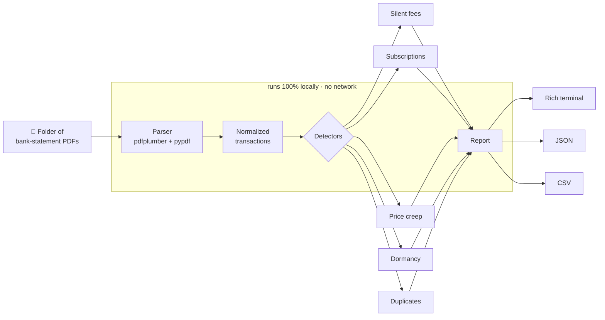

# leak-finder

> Local-first CLI that finds the money quietly leaking out of your Indian bank statements — silent fees, forgotten subscriptions, price-creep, dormancy, and double-charges.

[](LICENSE)
[](https://github.com/chirag127/leak-finder/stargazers)
[](https://github.com/chirag127/leak-finder/commits)
[](https://www.python.org/)
[](https://pypi.org/project/leak-finder/)

**Repo:** <https://github.com/chirag127/leak-finder> · **Landing:** <https://chirag127.github.io/leak-finder/>

> **Disclaimer:** General information, not financial/investment advice. leak-finder runs **100% locally** — no data ever leaves your machine.

Point it at a folder of bank-statement PDFs and it reports where your money is leaking: AMB/SMS/ATM fees, subscriptions you forgot to cancel, recurring debits that keep creeping up, dormant accounts with stranded balances, and duplicate charges. No signup, no cloud, no telemetry.

Banks don't make it easy to see the small charges that add up. leak-finder parses your statements offline and surfaces the leaks in a readable report you can act on.

⭐ If this is useful, please [star the repo](https://github.com/chirag127/leak-finder/stargazers) — it helps others find it.

## How it works



## What it detects

| Detector | What it finds |
|---|---|
| Silent fees | AMB/NMC penalties, SMS-alert fees, ATM charges, Demat AMC, GST on charges, cheque fees, etc. |
| Subscriptions | Same payee + similar amount on a monthly cadence |
| Price creep | A recurring debit whose amount increased over time |
| Dormancy | Accounts with no activity for N months; tiny stranded balances |
| Duplicates | Same amount + payee debited twice within a short window (IndusInd-style double SMS charges) |

## Features

- **Local-first & private** — no network calls, no telemetry, no analytics, no callbacks. PDFs and output stay on your machine.
- **Five detectors** out of the box (see table above).
- **Multiple output formats** — rich terminal report, JSON, or CSV.
- **Encrypted PDFs** — pass `--password` for folder-wide decryption.
- **Tunable thresholds** — dormancy window, tiny-balance cutoff.
- **Broad bank coverage** — table extraction first, regex line-scan fallback.

## Tech stack

- **Python 3.12+**, packaged with **hatchling**
- [`pdfplumber`](https://github.com/jsvine/pdfplumber) + [`pypdf`](https://pypdf.readthedocs.io/) — PDF parsing / decryption
- [`pandas`](https://pandas.pydata.org/) — transaction wrangling
- [`click`](https://click.palletsprojects.com/) — CLI
- [`rich`](https://rich.readthedocs.io/) — terminal report rendering

## Repo structure

```
leak_finder/
├── cli.py              # `leak-finder` entry point + flags
├── parser.py           # PDF → transactions (pdfplumber tables, regex fallback)
├── models.py           # Transaction / leak dataclasses
├── detectors/          # one module per detector
│   ├── fees.py
│   ├── subscriptions.py
│   ├── price_creep.py
│   ├── dormancy.py
│   └── duplicates.py
├── report.py           # aggregate leaks into a report
├── renderer.py         # rich terminal rendering
└── csv_export.py       # CSV output
tests/                  # pytest suite (one test file per detector)
```

## Install

```bash
# with uv (recommended)
uv tool install leak-finder

# or pip
pip install leak-finder
```

## Usage

```bash
# Scan all PDFs in a folder, rich terminal report
leak-finder scan ~/Downloads/statements/

# Password-protected PDFs (same password for all)
leak-finder scan ~/Downloads/statements/ --password ABCDE1234F

# Machine-readable JSON
leak-finder scan ~/Downloads/statements/ --json

# CSV export
leak-finder scan ~/Downloads/statements/ --csv

# Write report to file
leak-finder scan ~/Downloads/statements/ --out report.json
leak-finder scan ~/Downloads/statements/ --out report.csv

# Tune thresholds
leak-finder scan ~/Downloads/statements/ --dormancy-months 3 --tiny-balance 1000
```

### CLI reference

| Flag | Purpose |
|---|---|
| `--password <pw>` | Decrypt password-protected PDFs (same password for all files) |
| `--json` | Emit machine-readable JSON |
| `--csv` | Emit CSV |
| `--out <path>` | Write report to a file (format inferred from extension) |
| `--dormancy-months <n>` | Months of inactivity before flagging dormancy |
| `--tiny-balance <amount>` | Threshold for flagging tiny stranded balances |

## Configuration

None. leak-finder is a local tool with **no environment variables** — everything is passed via flags, and nothing is read from or written to the network.

## Sample output

```
╭─ Money Leak Report · 2024-06-01 ─────────────────────────────────────────────╮
│ Grand total leaked: ₹5,432.00  (fees ₹1,891.00 | subs ₹2,596.00 | dupes ₹299.00) │
╰───────────────────────────────────────────────────────────────────────────────╯

──────────────────────── hdfc_savings ─────────────────────────────────────────

 Silent fees  (₹1,891.00)
 Date        Category                  Narration                    Amount
 2024-01-15  Minimum Balance Penalty   AMB CHRG INC GST JAN24      ₹590.00
 2024-01-16  GST on Charges            GST ON CHG JAN24             ₹18.00
 2024-01-20  SMS Alert Fee             SMS ALERT CHG Q4             ₹25.00

 Action: Dispute / write to bank for fee reversal.
```

## Supported statement formats

Uses `pdfplumber` table extraction first, then regex line-scan fallback. Works with most Indian bank statements that have tabular layouts: HDFC, ICICI, SBI, Axis, Kotak, IndusInd, YES Bank, PNB, BOI, IDFC, Federal.

Encrypted PDFs: pass `--password` (same password for all files in the folder). Per-file passwords → decrypt manually first.

## Security & privacy

- **100% local.** All processing happens on your machine. No upload, no cloud, no data leaves your device.
- **No secrets in the repo.** No API keys, no tokens, no credentials — it never talks to a server.
- **No telemetry.** No analytics, no callbacks, no tracking.

## Development

```bash
git clone https://github.com/chirag127/leak-finder
cd leak-finder
uv venv && uv pip install -e ".[dev]"
pytest
```

## Part of the oriz family

leak-finder is one of ~80 [oriz](https://blog.oriz.in) projects. It's a CLI that **runs locally — no server, no hosting**.

## Contributing

Issues and PRs welcome. Conventional commits are the changelog.

## Status

Beta — actively used, detectors stable, more bank formats being added.

## License

MIT © 2026 Chirag Singhal · chirag@oriz.in — see [LICENSE](LICENSE).
